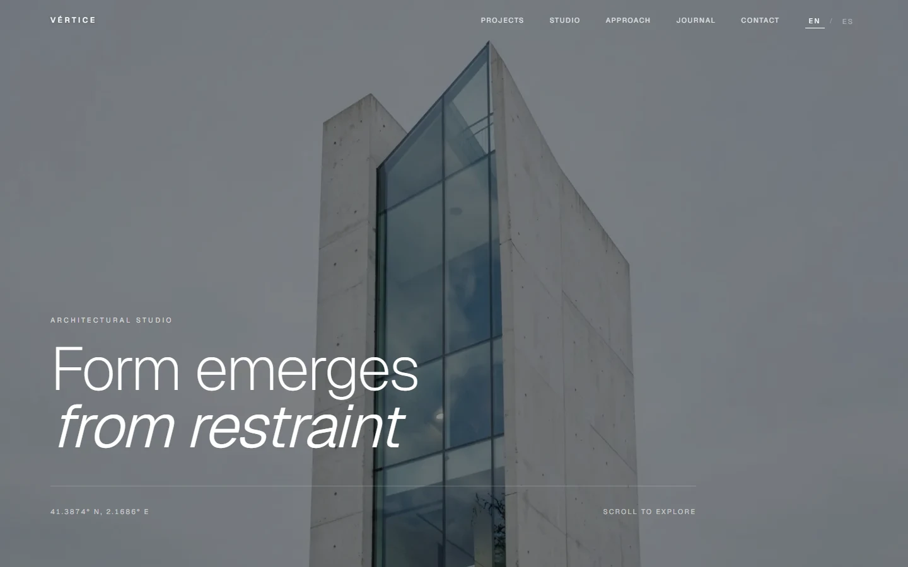

# Vértice — Architecture Studio Landing

Form emerges from restraint. A bilingual, editorial landing page for a contemporary architecture practice working in concrete, stone and light.



## Overview

Vértice Arquitectura is a studio site built around restraint: a full-bleed architectural hero, a four-project index, a material manifesto, and a journal. The layout follows the slow editorial rhythm of the reference while every word, asset and interaction has been rebuilt for production.

The site ships statically for both locales, self-hosts every image and font, and generates social cards at build time.

## Key Features

- **Bilingual routing (`en` / `es`):** Typed dictionaries, `/[locale]` App Router segments, `Accept-Language` negotiation, and a `vertice.locale` cookie so a visitor's choice survives navigation.
- **Consistent locale metadata:** Canonical URLs, `hreflang` alternates with `x-default`, per-locale OpenGraph tags, and a localized sitemap.
- **Scroll-reveal choreography:** A single `IntersectionObserver` hook drives staggered section entrances without a motion library.
- **Self-hosted imagery:** Six architectural photographs generated for this project and served from `public/images` through `next/image` — no stock libraries, no remote media.
- **Self-hosted typography:** Geist and Geist Mono are bundled at build time via `next/font/google`; the browser never contacts a font CDN.
- **Design tokens in CSS:** Tailwind CSS v4 with CSS-first `@theme` mapping, so palette changes live in one file.

## Tech Stack

- **Framework:** Next.js 16.4.3 (App Router, Turbopack)
- **Library:** React 19.2.4
- **Language:** TypeScript 5.7.3 (strict)
- **Styling:** Tailwind CSS 4.3.3 with CSS custom properties
- **Icons:** Lucide React
- **Analytics:** `@vercel/analytics`
- **Package Manager:** pnpm 11.17

## Architecture

```
vertice-arquitectura/
├── docs/
│   ├── provenance.md          # Compliance ledger and transformation history
│   └── screenshot.webp        # Visual preview artifact
├── public/
│   └── images/
│       ├── editorial/         # Hero and material-detail photography
│       └── projects/          # Four project photographs
├── src/
│   ├── app/
│   │   ├── [locale]/
│   │   │   ├── layout.tsx     # Locale shell, font variables, analytics
│   │   │   ├── not-found.tsx  # Localized 404
│   │   │   ├── opengraph-image.tsx # 1200x630 social card generator
│   │   │   └── page.tsx       # Composed landing route
│   │   ├── globals.css        # Design tokens and base layers
│   │   ├── icon.svg           # Brand mark and favicon
│   │   ├── robots.ts          # Crawler rules
│   │   └── sitemap.ts         # Multilingual sitemap
│   ├── components/            # Hero, projects, studio, approach, journal, contact
│   ├── config/site.ts         # Domain and locale configuration
│   ├── hooks/use-scroll-reveal.ts
│   ├── i18n/
│   │   ├── config.ts          # Locale list and cookie name
│   │   ├── dictionaries/      # Typed English and Spanish copy
│   │   └── get-dictionary.ts
│   ├── lib/seo.ts             # Canonical and hreflang metadata builder
│   └── proxy.ts               # Locale detection and persistence
├── eslint.config.mjs
├── next.config.ts
├── package.json
└── tsconfig.json
```

## Getting Started

### Prerequisites

- Node.js >= 20.9.0
- pnpm >= 10.0.0

### Installation

```bash
git clone https://github.com/JORDANROBERTO74/vertice-arquitectura.git
cd vertice-arquitectura
pnpm install
```

### Development

```bash
pnpm dev
```

Visit [http://localhost:3000](http://localhost:3000). The root redirects to `/en` or `/es` based on the request.

### Quality Checks

```bash
pnpm typecheck   # TypeScript, no emit
pnpm lint        # ESLint flat config
pnpm build       # Production build
```

## Deployment

The site is deployed on Vercel and builds with the default Next.js preset. Import the repository, or run:

```bash
vercel deploy --prod
```

Set `NEXT_PUBLIC_SITE_URL` when serving from a custom domain; otherwise the canonical URL falls back to `https://vertice-arquitectura.vercel.app`.

## Performance & SEO

- Static generation for `/en` and `/es`, with the locale redirect handled by edge middleware.
- All photography is served through `next/image` with responsive sizing and AVIF/WebP negotiation.
- `sitemap.xml` and `robots.txt` are generated from the locale configuration.
- OpenGraph and Twitter cards are produced at request time from the same dictionaries as the page, so titles never drift.
- No layout shift from fonts: `next/font` preloads and applies `size-adjust` metrics automatically.

## Accessibility

- Semantic landmarks (`header`, `main`, `nav`, `section`, `footer`) and a single `h1` per locale.
- The language switcher exposes `aria-current="page"` and a labelled group.
- Focus states are visible on all links and controls; motion is limited to a short opacity/translate reveal.
- Colour pairs target WCAG AA against the paper background.

## Compliance & Licensing

This project was rebuilt under clean-room principles:

- No proprietary trademarks, third-party logos, stock photography, or celebrity likenesses.
- All copy and Spanish translations are original to this project.
- The six photographs were generated for this build and are distributed with the repository.
- The full audit trail lives in [`docs/provenance.md`](docs/provenance.md).

## License

This project is licensed under the MIT License — see the [LICENSE](LICENSE) file for details.
